# VPS Monitoring and Security | DevOps Internship Project

During my DevOps internship at **Uyar Technologies**, I worked on a hands-on monitoring and security implementation to understand how a small cloud server can be monitored, how application downtime can be detected, and how selected failures and security events can be handled.

This repository documents the setup, test results, screenshots, troubleshooting, and lessons learned. The implementation was tested on a small cloud VM with a website and containers. 

## Project Objectives

- Detect website and service downtime using uptime monitoring.
- Observe server resource usage and container health.
- Test Docker restart behavior and understand the limits of health checks.
- Configure and verify brute-force protection.
- Send actionable notifications and document gaps discovered during testing.

## Tools and Technologies

The following free or self-hosted tools were selected for the implementation:

| Need | Tool | Cost |
|---|---|---|
| Uptime and SSL checks, status page | Uptime Kuma | Free, self-hosted |
| Server health (CPU, RAM, disk, network, containers) | Netdata | Free agent |
| Crash recovery | Docker restart policy + HEALTHCHECK, PM2, systemd | Free |
| Brute-force protection | Fail2ban or CrowdSec, host firewall | Free |
| DDoS and bot filtering | Cloudflare in front of the origin | Free plan available |
| Alerts | Telegram bot, email (SMTP) as backup | Free |

Consider paid platforms only when server count or maintenance effort grows.

## Implementation Findings

### Crash detection and recovery
- A Docker `unless-stopped` restart policy restarts a container that **exits**. It does not restart one that is **hung but still running**.
- A `HEALTHCHECK` only marks a container unhealthy. Plain Docker will not restart it; use an add-on such as autoheal or an external check that alerts a person.
- PM2 covers crashed Node.js processes; systemd (`Restart=always`) covers other services.
- The uptime monitor must run on a **different server** from the one it watches, or a full outage silences it too.
- A restart is recovery, not a fix. Repeated restarts must alert a human.

### Traffic, load and performance
- Use web server access logs and Netdata charts for requests, connections and bandwidth.
- Rate limiting, caching and a CDN protect against abuse.
- Establish capacity with a load test (Apache Bench or k6) on a test server, not production.
- Log request time and upstream time to find slow endpoints; enable the database slow query log.
- Use the four golden signals as a checklist: latency, traffic, errors, saturation.

### Security
- Baseline: key-only SSH, root and password login disabled, only required ports open, databases not exposed, automatic security updates, brute-force protection, secrets outside the repo, tested off-server backups.
- Docker-published ports can bypass host firewall rules such as UFW. Bind internal services to localhost and expose them through a reverse proxy.
- Monitoring dashboards can become an attack surface. Never expose them to the internet without access control.
- A single VPS cannot absorb a large DDoS; put a CDN/WAF in front and restrict the origin to its ranges.
- Malware and tampering need separate tools: ClamAV, rkhunter, Lynis, AIDE.

### Alerts
- Telegram as the primary channel, email as backup. WhatsApp is only practical through paid or unofficial providers, so it is not recommended as primary.
- Separate warning from critical, require conditions to persist for a few minutes, and alert only on actionable events.

Starting thresholds (tune on real traffic):

| Condition | Severity | Rule |
|---|---|---|
| Website or API down | Critical | 2 to 3 consecutive failed checks |
| SSL expiring | Warning, then critical | 14 days, then 3 days |
| Disk usage | Warning, then critical | Above 80%, then above 90% |
| RAM / CPU | Warning | RAM above 90% or CPU above 85% for 5 minutes |
| Container restarting repeatedly | Critical | More than 3 restarts in 10 minutes |
| Backup job did not report | Critical | Missed heartbeat |

### Tool comparison

| Tool | Uptime/SSL | Server metrics | Auto-restart | Security | History |
|---|---|---|---|---|---|
| Uptime Kuma | Yes | No | No | No | Basic |
| Netdata | No | Yes | No | Partial | Short, local |
| Docker restart / PM2 / systemd | No | No | Yes | No | No |
| Fail2ban / CrowdSec | No | No | No | Yes | No |

### Known gaps and mitigations

| Gap | Mitigation |
|---|---|
| Hung app that is still running | HTTP check in Kuma; healthcheck plus autoheal or an alert |
| Monitor on the same server | Run it on a separate server or add a hosted external check |
| Large DDoS | CDN/WAF in front; origin allows only its ranges |
| Malware and file tampering | Scheduled ClamAV, rkhunter, Lynis, AIDE |
| Exposed dashboards | Bind to localhost and use a tunnel, or an IP allow-list |
| Small VPS memory | Measure first; keep heavier monitoring components on a separate server |
| Alert fatigue, no escalation | Warning/critical levels, repeat alerts, paging if after-hours support is promised |

## Test Environment and Results

**Environment:** a small cloud VM (under 1 GB RAM plus swap), Docker, and a sample three-container website (frontend, backend, database).

| Test | Result |
|---|---|
| Downtime detection (Kuma, 60 s interval, 2 retries) | DOWN and UP alerts received |
| Telegram alert delivery | Test, DOWN and UP messages received |
| Crash recovery (process killed on host) | Container restarted automatically |
| Manual stop (`docker kill`) | Not restarted; Docker treats it as a deliberate stop |
| Hung container (failing healthcheck) | Marked unhealthy, **0 restarts** |
| Netdata | Private access only; about 190 MiB memory; CPU peak about 53% during a stress test |
| Fail2ban | Repeated failed logins produced an automatic ban and a real firewall block |
| SSH hardening check | Password login off, key-only |
| Load test (Apache Bench, 1,000 requests, concurrency 10) | 2,725 req/s, 0 failed (very short run, static page only) |
| Netdata alert delivery | Delivered by email; Telegram delivery not confirmed |

Memory footprint on the small VM: Uptime Kuma about 135 MiB, Netdata about 190 MiB, Fail2ban about 24 MiB.

### Screenshots (sensitive details redacted)

**Downtime detection and alerts**

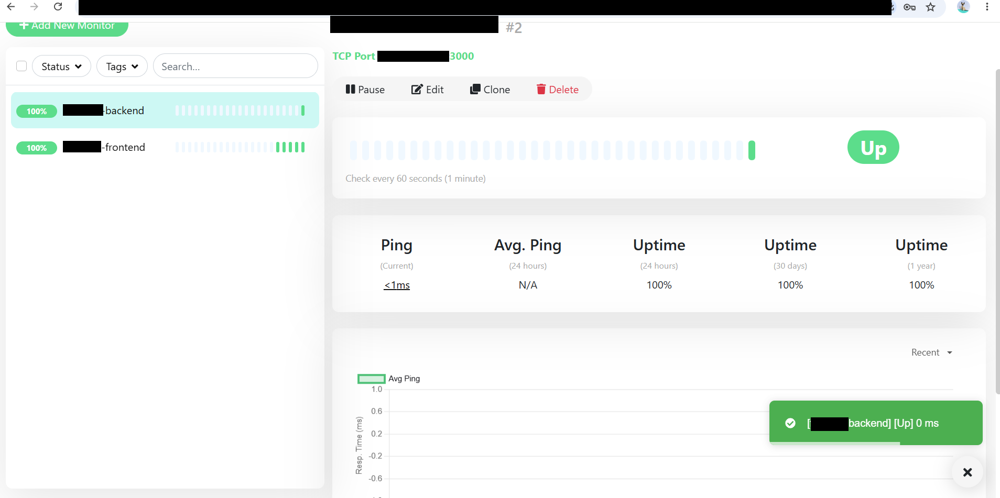

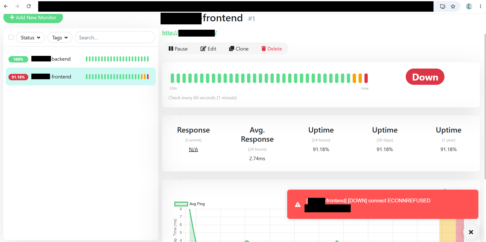

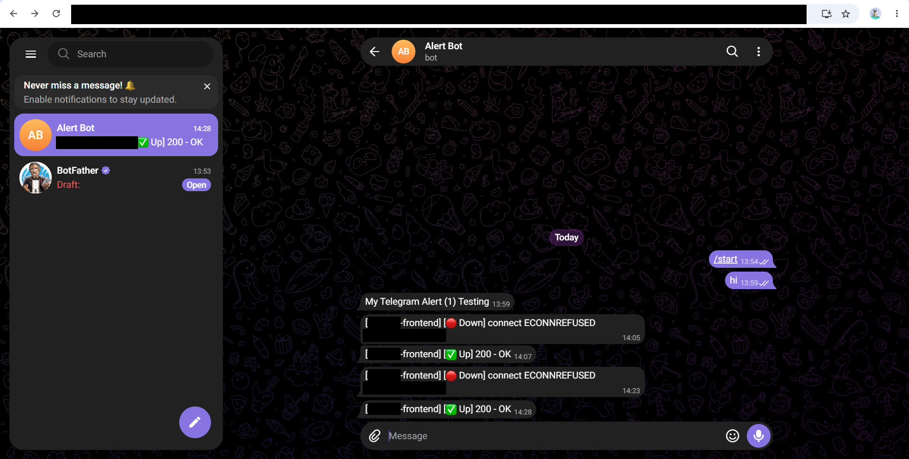

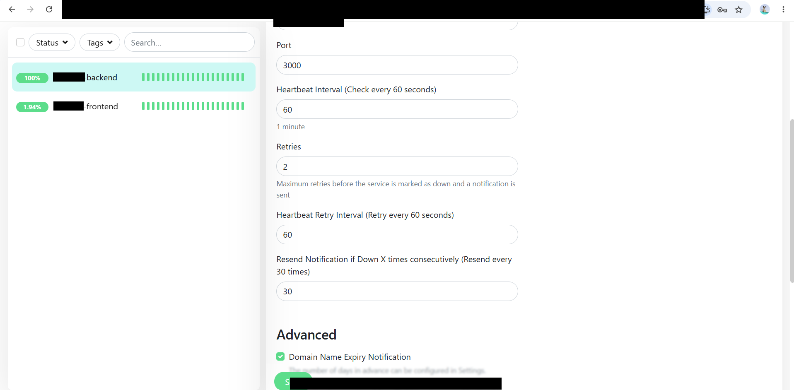

**Crash recovery and hung containers**

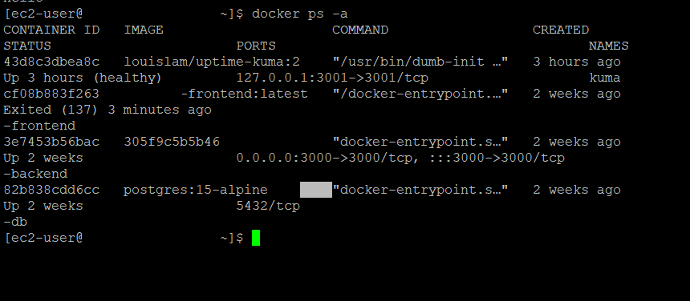

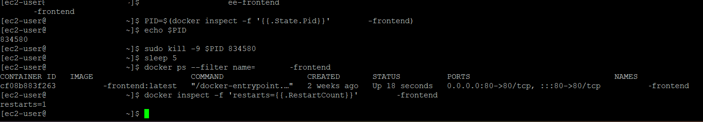

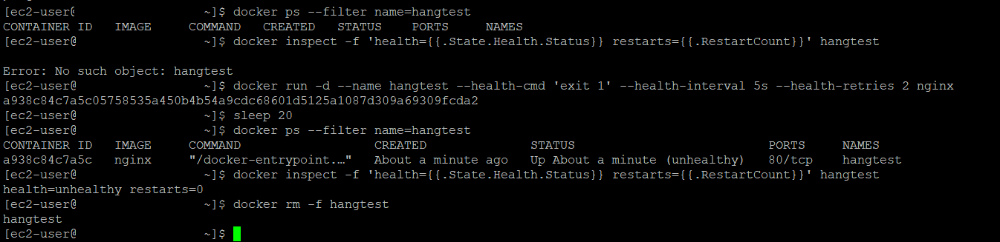

**Server health with Netdata**

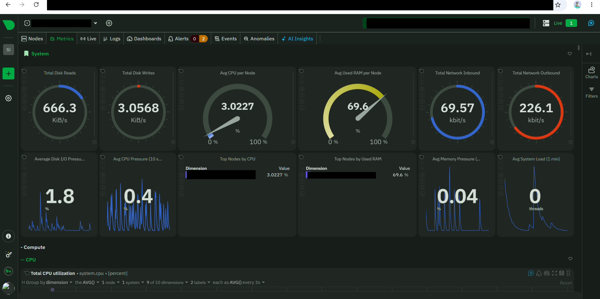

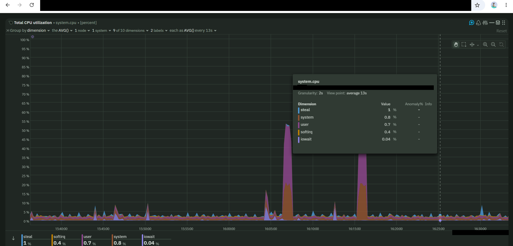

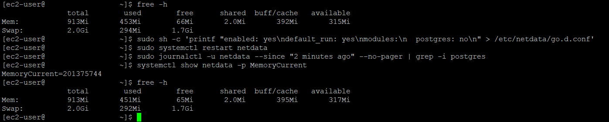

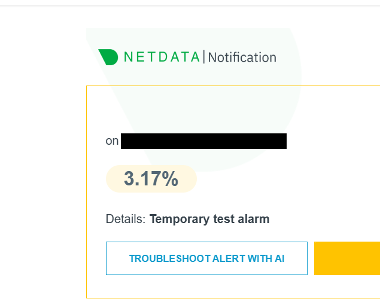

**Brute-force protection with Fail2ban**

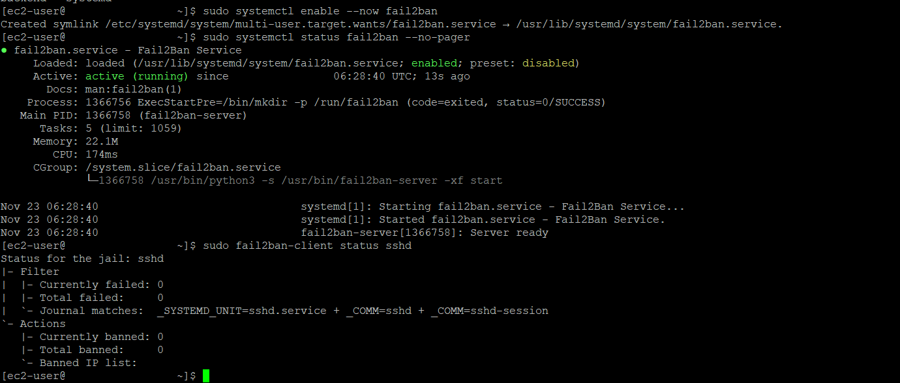

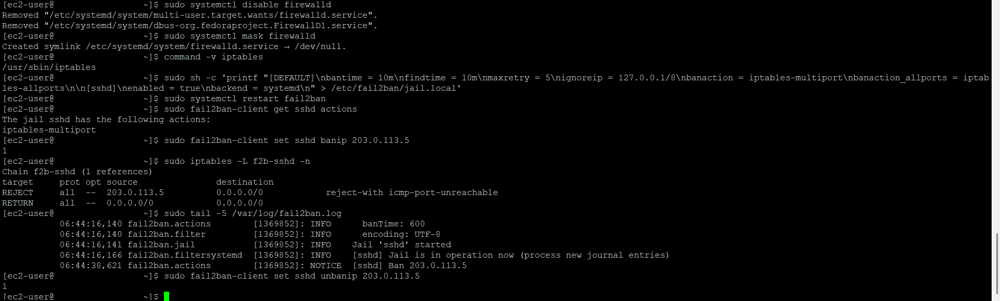

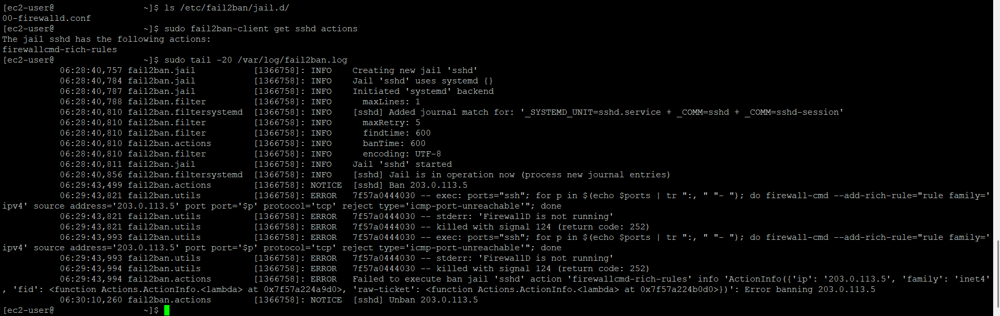

**Resources and load test**

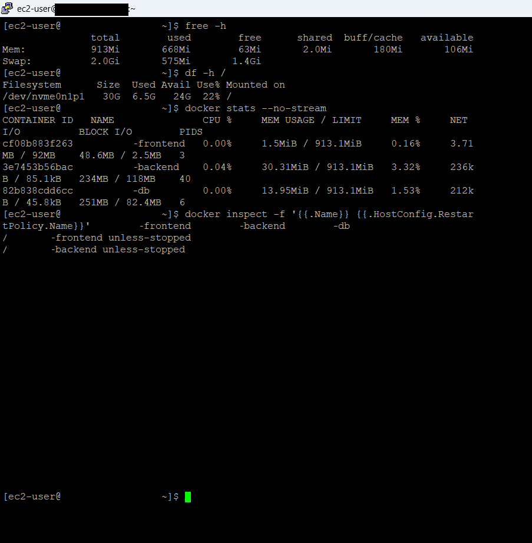

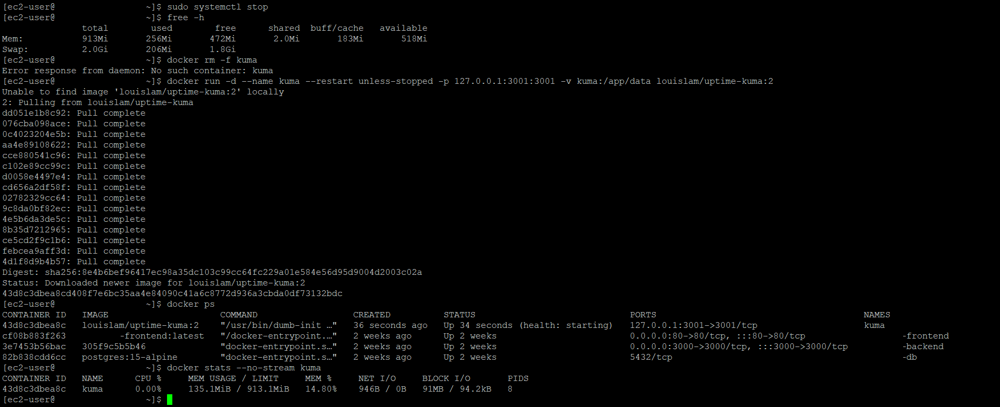

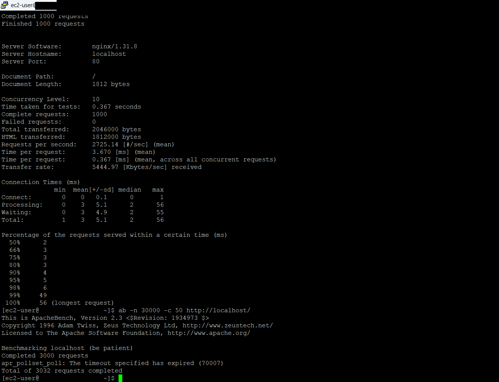

## Mistakes and Lessons

| Mistake | Lesson |
|---|---|
| Used `docker kill` as the crash test | Docker treats it as a manual stop. Kill the container's main process to simulate a real crash. |
| Fail2ban's default ban action pointed at a firewall service that was not running | A ban in the list is not proof of a block. Verify the actual firewall rule and the log. |
| Fail2ban ignored the server's own address during self-testing | It ignores local addresses by default; adjust temporarily to test, then revert. |
| Netdata auto-discovery probed the database with a default login | Review what auto-discovery probes before leaving it on. |
| Tool stack crowded a tiny server | Measure free memory before installing; use a larger instance or a separate monitoring server. |
| A service stopped and the single DOWN alert went unnoticed for about two days | A single alert is not enough. Repeat alerts, and keep tests off the live application. |
| Load test ran under half a second | A capacity test needs a longer run and must exercise the backend path. |

## Limitations

- Small shared test server with a sample site; not representative of production capacity.
- An outside uptime check (needed to detect a whole-server outage) was not set up.
- Netdata-to-Telegram delivery was configured but not demonstrated.
- Alert delay was not measured separately.
- Thresholds are starting values.

## Conclusion and Next Steps

This internship project provided hands-on practice with uptime monitoring, server metrics, Docker recovery behavior, alerting, and Linux security checks. The tests showed that monitoring and security controls must be verified in practice: Docker health checks do not restart unhealthy containers by themselves, firewall bans must be confirmed at the firewall level, and a single alert can be missed.

Next steps are to add an external uptime check, verify Netdata-to-Telegram delivery end to end, and move monitoring to a separate server so a full server outage does not disable its own monitoring. These improvements have not yet been demonstrated in this test environment.

## References

- Uptime Kuma: github.com/louislam/uptime-kuma
- Netdata: learn.netdata.cloud
- Docker (restart policies, healthchecks, packet filtering): docs.docker.com
- Fail2ban: github.com/fail2ban/fail2ban
- Nginx `limit_req`: nginx.org/en/docs
- PM2: pm2.keymetrics.io
